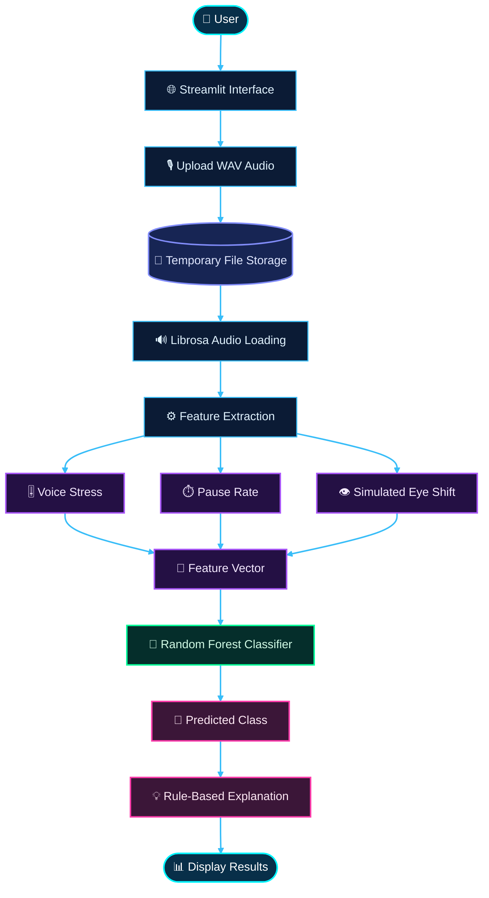
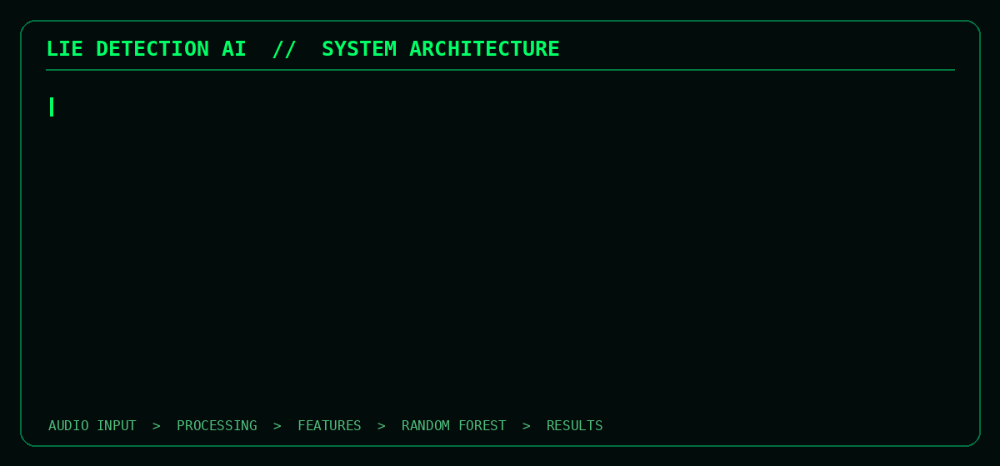

 <p align="center">
  
</p>

<p align="center">
  <b>A Machine Learning-Based Voice Analysis System</b>
</p>

<p align="center">
  
</p>

<p align="center">
  
  
  
</p>

---


‧₊˚🖇️✩ ₊˚🎧⊹♡ ⫘⫘⫘⫘⫘⫘     note  ⫘⫘⫘⫘⫘⫘  ‧₊˚🖇️✩ ₊˚🎧⊹♡


there is a file with full code but u need to send me email to explain to u how can u use it   and thanks 


‧₊˚🖇️✩ ₊˚🎧⊹♡ ⫘⫘⫘⫘⫘⫘     note  ⫘⫘⫘⫘⫘⫘  ‧₊˚🖇️✩ ₊˚🎧⊹♡


# 1. Abstract
 <p align="center">
  
  <br>
  
</p>

The Lie Detection AI project is an artificial intelligence-based application designed to analyze selected characteristics of human speech using audio signal processing and machine learning techniques. The system allows users to upload an audio recording in WAV format, extracts numerical features from the audio signal, and processes these features using a Random Forest classifier to generate a binary prediction.

The application is developed using Python and integrates several libraries, including Streamlit for the user interface, Librosa for audio processing, NumPy for numerical computations, Pandas for data management, and Scikit-learn for machine learning.

The current prototype analyzes three features: voice stress, pause rate, and an estimated speech-related indicator. These features are passed to the classification model, which produces a predicted class displayed as either “LIE” or “TRUTH.” The application also provides a basic rule-based explanation based on the extracted features.

The primary objective of this project is to demonstrate the integration of audio signal processing, machine learning, and interactive web application development. However, the current implementation uses a very small synthetic dataset, and one of its features is artificially calculated. Therefore, its predictions are experimental and cannot be considered scientifically reliable evidence of deception or truthfulness.

**Keywords:** Artificial Intelligence, Machine Learning, Lie Detection, Audio Signal Processing, Random Forest, Python, Streamlit, Voice Analysis.


2. Introduction
 
 <p align="center">
  
  <br>
  
</p>

   Artificial Intelligence has become an important technology in the development of intelligent systems capable of processing data, identifying patterns, and generating predictions. One of its applications is speech analysis, which involves examining acoustic characteristics of human speech through digital signal processing and machine learning techniques.

Human speech contains several measurable characteristics, including amplitude, pitch, speaking rate, pauses, and variations in vocal intensity. These characteristics may change depending on a person's emotional state, environment, or speaking conditions. Analyzing these variations provides an opportunity to explore how machine learning can be applied to speech-related data.

The Lie Detection AI project was developed as an educational prototype to demonstrate how an artificial intelligence pipeline can process an audio recording, extract numerical features, and generate a classification result through a trained machine learning model.

The system combines Python-based audio processing with a simple interactive interface, allowing users to upload audio files and view the extracted features and predicted class. The project was also presented in a university competition in collaboration with the Wamidh Club.

Although the application uses the terminology of lie detection, its current capabilities are limited to experimental feature analysis and classification. It does not establish whether a speaker is actually lying. Instead, it demonstrates the technical workflow required to build an audio-based machine learning application and provides a foundation for future improvements.

3. Project Description
 <p align="center">
  
  <br>
  
</p>

The Lie Detection AI system is a web-based application that processes uploaded audio recordings and generates a machine learning classification result.

The application follows a sequence of operations. First, the user uploads an audio file in WAV format. The application temporarily stores the file so that it can be processed. Next, the audio signal is loaded using Librosa, and selected numerical characteristics are calculated.

The extracted features are then passed to a Random Forest classifier that has been trained using a small predefined dataset. The model predicts one of two classes, represented by the labels 0 and 1. The application maps these labels to the displayed categories “TRUTH” and “LIE.”

Finally, the interface presents the audio recording, the calculated feature values, the predicted class, and a simple explanation based on predefined thresholds.

The application is designed to be simple and interactive, making it suitable for demonstrating the integration of data processing, machine learning, and web development in a single project. 


3. Project Description
 <p align="center">
  
  <br>
  
</p>
The Lie Detection AI system is a web-based application that processes uploaded audio recordings and generates a machine learning classification result.
The application follows a sequence of operations. First, the user uploads an audio file in WAV format. The application temporarily stores the file so that it can be processed. Next, the audio signal is loaded using Librosa, and selected numerical characteristics are calculated.
The extracted features are then passed to a Random Forest classifier that has been trained using a small predefined dataset. The model predicts one of two classes, represented by the labels 0 and 1. The application maps these labels to the displayed categories “TRUTH” and “LIE.”
Finally, the interface presents the audio recording, the calculated feature values, the predicted class, and a simple explanation based on predefined thresholds.
The application is designed to be simple and interactive, making it suitable for demonstrating the integration of data processing, machine learning, and web development in a single project.


5. Problem Statement
 <p align="center">
  
  <br>
  
</p>
   
Analyzing human speech computationally presents several challenges because vocal characteristics vary between individuals and across different situations. Changes in speaking patterns may be associated with stress, anxiety, fatigue, environmental noise, or other factors.
The main problem addressed by this project is how to develop a simple application that processes speech recordings, extracts measurable audio features, and applies a machine learning classifier to produce a structured prediction.
The project explores the following question:
How can audio signal processing and machine learning be integrated into an interactive application for experimental speech-feature classification?
The current prototype addresses this question by implementing a basic feature extraction process, a Random Forest classification model, and an interactive Streamlit interface. Determining whether the predictions correspond to actual deception would require a much larger, carefully labeled dataset and rigorous scientific validation.


 <!-- ═══════════════════ PROJECT OBJECTIVES — NEON EDITION ═══════════════════ -->

<h2 align="center">🎯 PROJECT OBJECTIVES</h2>

<p align="center">
  
</p>

<p align="center">
  
  
  
</p>

### 🧠 Main Objective

The main objective of **LIE DETECTION AI** is to develop an interactive machine learning application that demonstrates the processing, feature extraction, and classification of audio data. The project integrates Python-based audio analysis with an accessible user interface to illustrate a practical AI workflow, from audio input to model prediction and result visualization.

---

### ⚡ SPECIFIC OBJECTIVES

<table>
  <tr>
    <td width="50%" valign="top">
      <h3>🎙️ 01 · Audio Upload</h3>
      Develop a user-friendly interface that allows users to upload audio recordings for analysis.
    </td>
    <td width="50%" valign="top">
      <h3>⚙️ 02 · Audio Processing</h3>
      Process audio files using Python-based audio processing tools and prepare signals for feature extraction.
    </td>
  </tr>
  <tr>
    <td width="50%" valign="top">
      <h3>📊 03 · Feature Extraction</h3>
      Extract numerical features from audio signals to create structured inputs for the classification model.
    </td>
    <td width="50%" valign="top">
      <h3>🌲 04 · Random Forest</h3>
      Implement a Random Forest classification algorithm to analyze extracted features and produce model predictions.
    </td>
  </tr>
  <tr>
    <td width="50%" valign="top">
      <h3>🔮 05 · Binary Prediction</h3>
      Generate a binary classification output based on the model's learned patterns and the supplied audio features.
    </td>
    <td width="50%" valign="top">
      <h3>📈 06 · Result Visualization</h3>
      Display extracted feature values and classification results through a clear, accessible interface.
    </td>
  </tr>
  <tr>
    <td width="50%" valign="top">
      <h3>💡 07 · Rule-Based Explanation</h3>
      Provide simple, rule-based explanations of selected feature values to help users interpret the displayed results.
    </td>
    <td width="50%" valign="top">
      <h3>🔗 08 · AI Integration</h3>
      Demonstrate the practical integration of Artificial Intelligence, Python-based processing, and web application development.
    </td>
  </tr>
  <tr>
    <td width="50%" valign="top">
      <h3>🔬 09 · Limitations & Improvements</h3>
      Identify prototype limitations and outline potential improvements in data quality, feature engineering, model validation, and usability.
    </td>
    <td width="50%" valign="top">
      <h3>🚀 10 · Future Research</h3>
      Establish a foundation for more rigorous research into speech analysis, audio classification, and machine learning.
    </td>
  </tr>
</table>

---

### 🔄 OBJECTIVE EXECUTION PIPELINE

<p align="center">
  
  ➜
  
  ➜
  
</p>

<p align="center">⬇️</p>

<p align="center">
  
  ➜
  
</p>

---

### 🏆 EXPECTED OUTCOMES

- A functional interface for audio upload and analysis.
- An audio-processing workflow that extracts numerical features.
- A Random Forest model integrated into the application.
- A presentation layer for predictions and extracted feature values.
- Simple explanations of selected features based on predefined rules.
- A documented assessment of prototype limitations and future development opportunities.

<p align="center">
  
</p>

> **Scientific note:** The binary output represents the model's predicted class, not proof that a person is lying or telling the truth. Voice-based predictions can be affected by dataset bias, recording conditions, individual differences, and model limitations.

<p align="center">
  
</p>

<p align="center">
  <b>🎙️ AUDIO PROCESSING · 🌲 RANDOM FOREST · 🧠 ARTIFICIAL INTELLIGENCE · 🚀 INNOVATION</b>
</p>

<!-- ═══════════════════ END OF PROJECT OBJECTIVES ═══════════════════ -->


6. Project Scope
 <p align="center">
  
  <br>
  
</p>
 The scope of the current project is limited to a proof-of-concept application that accepts WAV audio recordings and classifies extracted numerical features using a predefined Random Forest model.
The implementation includes audio file uploading, temporary file storage, audio signal loading, basic feature calculations, machine learning prediction, and result visualization.
The current version does not include a large-scale training dataset, speaker identification, facial analysis, real-time recording, advanced speech recognition, or a scientifically validated deception detection method. In particular, the eye-shift feature is simulated from the voice-stress feature and does not represent an actual measurement of eye movement.
Consequently, the system should be considered an educational demonstration rather than a reliable lie detection instrument.

7. Technologies and Tools Used
 <p align="center">
  
  <br>
  
</p>
| Technology | Purpose |
|---|---|
| Python | Main programming language |
| Streamlit | Interactive web application interface |
| NumPy | Numerical calculations and signal analysis |
| Pandas | Dataset creation and feature organization |
| Librosa | Audio loading and processing |
| Scikit-learn | Machine learning and classification |
| Random Forest | Classification algorithm |
| Temporary Files | Intermediate storage of uploaded audio |


7.1. Python
 <p align="center">
  
  <br>
  
</p>

Python was selected because of its readable syntax and extensive ecosystem of libraries for artificial intelligence, scientific computing, and application development.


7.2. Streamlit
 <p align="center">
  
  <br>
  
</p>


Streamlit is used to build the user interface without requiring a separate frontend framework. It provides components for uploading files, displaying audio, presenting numerical values, and showing prediction results.


7.3. Librosa

 <p align="center">
  
  <br>
  
</p>


Librosa is used to load and process the uploaded audio recording. In the current implementation, the audio is converted into a numerical array that can be analyzed using NumPy.

7.4. NumPy
 <p align="center">
  
  <br>
  
</p>
NumPy performs numerical operations on the audio signal, including calculating its standard deviation and determining the proportion of samples whose absolute amplitude falls below a selected threshold.

7.5. Pandas

 <p align="center">
  
  <br>
  
</p>


Pandas organizes the predefined training examples into a DataFrame. Each row contains three input features and one target label.

7.6. Scikit-learn
<p align="center">
  
  <br/>
  
</p>
Scikit-learn provides the Random Forest classifier and the methods required to train the model and generate predictions.

8. System Architecture

<p align="center">
  
  <br/>
  
</p>

The system follows a simple machine learning pipeline:

## ⚡ SYSTEM ARCHITECTURE — LIE DETECTION AI



<p align="center">
  <b>🎙️ AUDIO INPUT → 🧬 FEATURE EXTRACTION → 🌲 RANDOM FOREST → 📊 RESULTS</b>
</p>


## 🟢 SYSTEM ARCHITECTURE — DESCRIPTION

<p align="center">
  
</p>


9. System Components
<p align="center">
  
  <br/>
  
</p>

9.1. User Interface Module  ×͜×

This module allows users to interact with the application. It displays the application title, provides an audio upload component, and presents the extracted features and prediction.

9.2. Audio Input Module.𖥔 ݁ ˖⋆ ˚❆

The audio input module accepts files with the WAV extension. Once a file is uploaded, its contents are written to a temporary file so that Librosa can load the recording from a file path.

9.3. Feature Extraction Module.𖥔 ݁ ˖⋆ ˚❆

This module transforms the audio signal into numerical features. The current implementation calculates voice stress and pause rate using simple signal statistics. It also calculates an artificial eye-shift indicator from the voice-stress value.

9.4. Machine Learning Module.𖥔 ݁ ˖⋆ ˚❆

The machine learning module uses a Random Forest classifier. The model is trained on a small predefined dataset and receives the extracted feature vector to produce a binary prediction.

9.5. Explanation Module.𖥔 ݁ ˖⋆ ˚❆

The explanation module checks whether the extracted feature values exceed predefined thresholds. If a threshold is exceeded, the corresponding explanatory message is displayed.
This module is rule-based and is separate from the Random Forest model. It does not explain the model's internal decision process.

9.6. Results Display Module.𖥔 ݁ ˖⋆ ˚❆

The results module presents the numerical features, predicted class, and available explanatory messages to the user.

11. Dataset Description
<p align="center">
  
  <br/>
  
</p>

The current prototype uses a small dataset created directly within the Python source code using Pandas.

The dataset contains ten observations. Each observation includes three numerical input features:

- Voice stress
- Pause rate
- Eye shift

The target variable is a binary label, where 0 represents the class displayed as “TRUTH” and 1 represents the class displayed as “LIE.”

The dataset is manually predefined rather than collected from real-world recordings. It is used to demonstrate the training and prediction workflow of a supervised machine learning model.

The dataset is not sufficiently large or representative to establish model accuracy, generalization, or scientific validity. Furthermore, the dataset does not provide a verified empirical relationship between the selected features and actual deception.

A future version should use a substantially larger, ethically collected, consent-based, and independently labeled dataset with separate training, validation, and test partitions.


11. Machine Learning Algorithm: Random Forest

<p align="center">
  
  <br/>
  
</p>

Random Forest is a supervised machine learning algorithm that combines multiple decision trees to perform classification or regression.

During training, the algorithm constructs a collection of decision trees using randomized samples and feature selection. During classification, the trees contribute their predictions, and the final class is determined through aggregation, commonly majority voting.

Random Forest is useful for demonstrating classification because it can model nonlinear relationships and interactions between numerical features without requiring a linear decision boundary.

In this project, the Random Forest classifier receives three input features and predicts one of two classes.

The model is trained using the `fit()` method and generates predictions using the `predict()` method.

However, using Random Forest does not automatically make a system accurate or reliable. The quality of the predictions depends on the quality, size, representativeness, and labeling of the training data, as well as appropriate model evaluation.

In the current implementation, the model is trained on only ten predefined examples. No independent test set or formal evaluation procedure is included.

# 🔷 12. Feature Extraction and Audio Processing

Feature extraction is the process of transforming raw audio into numerical measurements that can be used by a machine learning algorithm.

The current implementation defines three features.

---

## 🔹 12.1. Voice Stress

The code calculates:

```python
voice_stress = np.std(y) * 100
```

Here, `y` is the array of audio samples returned by Librosa.

The standard deviation measures the variation of the sample amplitudes around their mean. Multiplying this value by 100 changes its numerical scale.

> **⚠️ Important technical limitation:** This calculation does not directly measure psychological stress. It is an amplitude-variation statistic, and its value can depend on recording volume, microphone characteristics, background noise, and audio normalization.

---

## 🔹 12.2. Pause Rate

The code calculates:

```python
pause_rate = np.sum(np.abs(y) < 0.02) / len(y) * 10
```

This expression counts samples whose absolute amplitude is below 0.02, divides that count by the total number of samples, and multiplies the result by 10.

The calculation approximates the proportion of low-amplitude samples, scaled by a factor of ten.

It does not directly count pauses as linguistic events. Silence detection would require additional considerations, such as a minimum pause duration, frame-based energy measurements, and an appropriate threshold.

---

## 🔹 12.3. Eye Shift

The code calculates:

```python
eye_shift = voice_stress * 0.7
```

This feature is artificially generated from the voice-stress value. It is not extracted from a camera, image, or eye-tracking sensor.

Therefore, it must not be described as actual eye-movement detection.

For a scientifically sound audio-only system, this feature should be removed or replaced with a genuine acoustic feature. A real eye-movement analysis module would require a separate visual input pipeline and appropriate validation.

---

## 🔹 12.4. Feature Vector

The three calculated values are combined into a feature vector:

```python
[voice_stress, pause_rate, eye_shift]
```

This vector is passed to the Random Forest classifier.

The model expects the features in the same order used during training.

---

# 🔷 13. Methodology: How the Project Was Developed

The project development process can be divided into several stages.

### 🟦 Stage 1: Problem Definition

The initial step was to identify the project objective: creating an interactive application that demonstrates audio feature analysis and machine learning classification.

### 🟦 Stage 2: Technology Selection

Python was selected as the main programming language. Streamlit was chosen for the interface, Librosa for audio processing, NumPy for numerical calculations, Pandas for dataset organization, and Scikit-learn for the classification algorithm.

### 🟦 Stage 3: Dataset Preparation

A small dataset was defined directly in the source code. It contained three numerical features and a binary target label.

### 🟦 Stage 4: Model Training

The input features were separated from the target variable. A Random Forest classifier was initialized and trained using the `fit()` method.

### 🟦 Stage 5: Audio Processing

A feature extraction function was implemented to load the audio file and calculate the selected numerical indicators.

### 🟦 Stage 6: Prediction

The extracted values were passed to the trained model through the `predict()` method.

### 🟦 Stage 7: Explanation

A separate rule-based function was created to generate messages when certain feature values exceeded predefined thresholds.

### 🟦 Stage 8: Interface Integration

The modules were connected through Streamlit so that users could upload audio recordings and view the resulting features and classification.

### 🟦 Stage 9: Limitations and Future Improvements

The final stage involves identifying methodological limitations and defining improvements, including better data collection, validated acoustic features, systematic testing, and appropriate performance metrics.

---

<p align="center">
  <strong>🔹 AUDIO PROCESSING · FEATURE EXTRACTION · MACHINE LEARNING 🔹</strong>
</p>
---

## <span style="color:#00D9FF">14.1. Importing Libraries</span>

```python
import streamlit as st
import numpy as np
import pandas as pd
import librosa
import tempfile
from sklearn.ensemble import RandomForestClassifier
```

These statements import the libraries required by the application.

- `streamlit` builds the interface.
- `numpy` performs numerical calculations.
- `pandas` organizes the training data.
- `librosa` loads the audio recording.
- `tempfile` creates temporary files.
- `RandomForestClassifier` provides the machine learning algorithm.

---

## <span style="color:#00D9FF">14.2. Creating the Training Dataset</span>

```python
data = pd.DataFrame({
    "voice_stress": [8,7,2,9,1,6,8,3,7,2],
    "pause_rate":   [7,6,2,8,1,5,7,2,6,1],
    "eye_shift":    [8,7,2,9,1,6,8,2,7,1],
    "label":        [1,1,0,1,0,1,1,0,1,0]
})
```

A Pandas DataFrame is created with four columns. Three columns represent the input features, and the `label` column represents the target class.

The numerical values are manually specified. They are not calculated from a collection of real labeled voice recordings.

---

## <span style="color:#00D9FF">14.3. Separating Inputs and Labels</span>

```python
X = data[["voice_stress", "pause_rate", "eye_shift"]]
y = data["label"]
```

`X` contains the model's input features, while `y` contains the target labels.

This separation is standard practice in supervised machine learning.

---

## <span style="color:#00D9FF">14.4. Training the Model</span>

```python
model = RandomForestClassifier()
model.fit(X, y)
```

The first statement creates the classifier with Scikit-learn's default settings. The second trains it on the ten predefined observations.

Because no `random_state` or hyperparameters are specified, the experiment is not fully controlled for reproducibility.

The model is trained when the application script executes, rather than loaded from a previously saved model.

---

## <span style="color:#00D9FF">14.5. Extracting Audio Features</span>

```python
def extract_features(audio_path):
    y, sr = librosa.load(audio_path, sr=None)
    voice_stress = np.std(y) * 100
    pause_rate = np.sum(np.abs(y) < 0.02) / len(y) * 10
    eye_shift = voice_stress * 0.7
    return voice_stress, pause_rate, eye_shift
```

The function receives the path of the audio file and loads the audio samples.

The variable `y` contains the audio signal, and `sr` contains its sampling rate. The sampling rate is not used in the subsequent calculations.

The function calculates the three features and returns them as a tuple.

A production implementation should also validate empty recordings, audio duration, corrupted files, and numerical edge cases.

---

## <span style="color:#00D9FF">14.6. Generating Explanatory Messages</span>

```python
def explain(vs, pr, es):
    reasons = []
    if vs > 6:
        reasons.append("High voice stress detected")
    if pr > 6:
        reasons.append("Frequent pauses detected")
    if es > 6:
        reasons.append("Irregular speech pattern detected")
    return reasons
```

The function compares the feature values with predefined thresholds.

If a condition is satisfied, the corresponding message is added to a list.

This is a simple rule-based explanation. The thresholds are not shown to have been learned or validated from real data, and the messages do not prove deception.

---

## <span style="color:#00D9FF">14.7. Configuring the Interface</span>

```python
st.set_page_config(
    page_title="Lie Detection AI",
    layout="centered"
)

st.title("AI Lie Detection System")
st.write("Upload or record voice to detect truth vs lie")

audio_file = st.file_uploader(
    "Upload WAV audio",
    type=["wav"]
)
```

This section configures the page, displays the title and description, and creates an upload component that accepts WAV files.

Despite the text mentioning recording, the current code does not implement direct microphone recording. It only implements file uploading.

---

## <span style="color:#00D9FF">14.8. Storing and Playing the Audio</span>

```python
if audio_file is not None:
    with tempfile.NamedTemporaryFile(
        delete=False,
        suffix=".wav"
    ) as tmp:
        tmp.write(audio_file.read())
        path = tmp.name

    st.audio(audio_file)
```

The application checks whether the user has uploaded a file.

If a file is available, its contents are written to a temporary WAV file. The resulting path is saved in `path`, which is then used for feature extraction.

The audio player allows the user to listen to the uploaded recording.

A production version should also implement secure temporary-file handling and cleanup.

---

## <span style="color:#00D9FF">14.9. Displaying Features and Predicting a Class</span>

```python
vs, pr, es = extract_features(path)

st.subheader("Features")
st.write({
    "voice_stress": vs,
    "pause_rate": pr,
    "eye_shift": es
})

pred = model.predict([[vs, pr, es]])[0]
decision = "LIE" if pred == 1 else "TRUTH"

st.subheader("Decision")
st.title(decision)
```

First, the application extracts the feature values. It then displays them in the interface.

The `predict()` method receives one observation represented by a two-dimensional list. The returned class is mapped to the displayed label.

The prediction represents the classifier's output, not a verified judgment about the speaker's honesty.

---

## <span style="color:#00D9FF">14.10. Displaying the Explanation</span>

```python
st.subheader("AI Explanation")
reasons = explain(vs, pr, es)

for r in reasons:
    st.write("•", r)
```

The application calls the explanation function and displays each returned message.

If none of the conditions is satisfied, the list remains empty and no explanatory bullet points are displayed.

---

<p align="center">
  <sub>Built with Python, Streamlit, Librosa, Pandas, NumPy, and Scikit-learn.</sub>
</p>


# 🔷 15. Application Workflow

The application follows a sequence of steps, from audio upload to the presentation of the classification results.

1. **Application Launch:** The user opens the Streamlit application and uploads a WAV audio recording.

2. **Audio Processing:** The uploaded file is temporarily stored and loaded by the audio processing module.

3. **Feature Extraction:** The feature extraction function calculates the selected numerical values from the audio signal.

4. **Machine Learning Classification:** The resulting feature vector is passed to the Random Forest classifier, which returns a binary class.

5. **Result Presentation:** The interface displays the extracted values, the predicted class, and any explanatory messages generated by the rule-based function.

6. **Result Review:** The user reviews the displayed information.

> **Current implementation:** The current version does not include a database, user accounts, historical result storage, or direct microphone recording.

---

# 🔷 16. User Interface and Expected Output

The interface contains four principal elements:

| **Component** | **Description** |
|:---|:---|
| **Application title** | Identifies the system. |
| **Audio upload** | Allows the user to select a WAV file. |
| **Feature display** | Presents the calculated numerical values. |
| **Prediction and explanation** | Displays the classifier's output and rule-based messages. |

### 💻 Typical Output Structure

```text
AI Lie Detection System

Uploaded Audio: sample.wav

Features:
    voice_stress: [calculated value]
    pause_rate:   [calculated value]
    eye_shift:    [calculated value]

Decision:
    [LIE or TRUTH]

AI Explanation:
    [Messages generated by the threshold rules]
```

The bracketed values above are placeholders, not experimental results. Actual values depend on the uploaded audio and the execution environment.

---

# 🔷 17. How to Run the Project

Follow these steps to install the dependencies, launch the application, and test its basic functionality.

## 🔹 17.1. Install Python

Install a compatible Python version and create a project directory.

## 🔹 17.2. Install Dependencies

Run the following command in the terminal:

```bash
pip install streamlit numpy pandas librosa scikit-learn
```

## 🔹 17.3. Save the Source Code

Save the complete application in a file named:

```text
app.py
```

## 🔹 17.4. Launch the Application

Execute:

```bash
streamlit run app.py
```

Streamlit will start a local web server and provide a URL through which the application can be accessed.

## 🔹 17.5. Test the Application

Upload a valid WAV recording and verify that the application displays the audio player, numerical features, predicted class, and explanatory messages.

> **Testing status:** The current source code does not include automated tests, a performance benchmark, or a validation dataset.

---

# 🔷 18. Testing and Evaluation

Testing is an essential stage in the development of any machine learning application. It helps verify that the system processes input correctly, handles errors, and produces results in the expected format.

For the current prototype, functional tests should include valid WAV uploads, very short recordings, silent audio, corrupted files, and recordings with different durations and amplitudes.

The interface should be checked to ensure that uploaded files can be played and that the feature values and prediction are displayed.

Machine learning evaluation requires a separate procedure. A representative labeled dataset should be divided into training, validation, and test partitions. Suitable evaluation metrics may include accuracy, precision, recall, F1-score, confusion matrix analysis, and calibration where appropriate.

Because the current model uses only ten manually defined observations and has not been evaluated on an independent test set, no scientifically meaningful accuracy or reliability claim can currently be made.

**Functional correctness and predictive validity must be evaluated separately.**

## 🔹 18.1. Recommended Evaluation Metrics

The following table summarizes the recommended metrics and what each one measures.

| **Metric** | **Meaning** |
|:---|:---|
| **Accuracy** | Proportion of predictions that are correct. |
| **Precision** | Proportion of positive predictions that are correct. |
| **Recall** | Proportion of actual positive cases identified. |
| **F1-score** | Harmonic mean of precision and recall. |
| **Confusion Matrix** | Counts of correct and incorrect predictions by class. |
| **ROC-AUC** | Measures ranking discrimination across thresholds, when applicable. |

These metrics should only be reported after evaluating the model on suitable labeled data. They must not be invented for a presentation.

---

# 🔷 19. Advantages of the Project

The project has several advantages as an educational prototype.

### 🟦 Simple User Interface

Streamlit makes the application accessible to users without requiring advanced frontend development.

### 🟦 Integration of Multiple Technologies

The project combines Python, audio processing, numerical computation, data management, and machine learning.

### 🟦 Modular Code Structure

The implementation separates model training, feature extraction, explanation, and interface logic into identifiable sections.

### 🟦 Interactive Processing

Users can upload an audio file and immediately view the calculated features and classification output.

### 🟦 Practical Learning Experience

The project demonstrates a complete basic machine learning workflow, from data preparation to prediction.

### 🟦 Extensibility

The architecture can be extended with better features, improved datasets, model evaluation, and additional interface components.

### 🟦 Competition Demonstration

The project can serve as a practical demonstration of interdisciplinary teamwork and applied AI development in a university setting.

---

# 🔷 20. Limitations and Disadvantages

Despite its educational value, the current implementation has several important limitations.

| **Limitation** | **Technical Description** |
|:---|:---|
| **Very Small Dataset** | The model is trained on only ten manually defined examples, which is insufficient for reliable generalization. |
| **No Independent Evaluation** | The application does not include a test dataset or performance metrics. |
| **Simplified Voice Feature** | The standard deviation of the audio samples is not a validated measurement of psychological stress. |
| **Approximate Pause Measurement** | Counting low-amplitude samples does not reliably identify linguistic pauses. |
| **Simulated Eye-Shift Feature** | The eye-shift value is calculated from voice stress and is not derived from visual data. |
| **Limited Explanation** | The explanatory messages are based on manually defined thresholds rather than a validated explanation of the classifier. |
| **Potential Scale Mismatch** | The training data contains small integer values, while the extracted features can have different ranges. This can cause the model to receive inputs that differ substantially from its training examples. |
| **Sensitivity to Recording Conditions** | Recording volume, background noise, microphones, and audio duration can influence the extracted values. |
| **Lack of Scientific Validation** | Vocal characteristics alone do not establish whether a person is lying. |
| **Limited Error Handling** | The code does not comprehensively handle corrupted files, empty signals, or every possible audio-processing error. |
| **Temporary-File Management** | The current implementation creates temporary files without explicit cleanup. |
| **No Direct Recording** | Despite the introductory text, microphone recording is not implemented in the current code. |

These limitations should be considered when interpreting the system's output and planning future development.

---

# 🔷 21. Ethical Considerations

AI systems that classify human behavior can create ethical risks when their predictions are interpreted as objective facts.

A false accusation of deception can damage trust, reputation, or personal relationships. The system may also behave differently across speakers because of differences in accent, language, vocal characteristics, disability, emotional state, or recording conditions.

For these reasons, the current prototype must not be used to make employment, legal, academic, disciplinary, or other high-stakes decisions.

Audio recordings should be collected with informed consent, processed securely, and retained only when necessary. Any future dataset should be reviewed for privacy risks, representativeness, and labeling quality.

The system should communicate uncertainty clearly and avoid presenting its predictions as proof of dishonesty.

**The responsible objective is to explore speech analysis and machine learning rather than to make unsupported judgments about an individual's truthfulness.**

---

<p align="center">
  <strong>🔹 AUDIO ANALYSIS · MACHINE LEARNING · RESPONSIBLE AI 🔹</strong>
</p>
